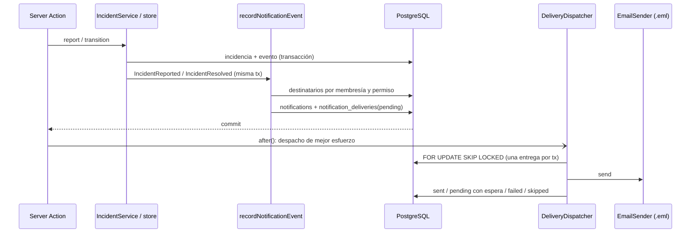

# Notifications I — Notificaciones in-app y correo transaccional

Fecha: 14 de octubre de 2026. Estado: implementado; políticas en el [ADR 0019](../decisions/0019-notifications-email.md) (**Propuesta**, pendiente de aprobación). SRS §19, §26, §33.14 y §34.1.

## Alcance

- Centro de notificaciones persistente por usuario (`/app/notifications`) con contador de no leídas en el menú.
- Correo transaccional para dos eventos de Incidents I: reporte de severidad alta (a quienes revisan) y resolución (a quien reportó).
- Outbox en PostgreSQL con reintentos y adaptador de correo local en archivos `.eml`.

Fuera de alcance: Amazon SES, push/PWA, preferencias, recordatorios programados, programación periódica del despacho, retención y eventos de otros módulos.

## Flujo



`pnpm notifications:dispatch` ejecuta el mismo despachador (hasta 500 entregas) para reintentos o cuando `after()` no llegó a correr.

## Capas

```text
src/modules/notifications/
  domain/notifications.ts            eventos, plan por evento, rutas, espera exponencial, render del correo
  application/notifications.ts       NotificationService: list, unreadCount, markRead, markAllRead
  application/delivery-dispatcher.ts DeliveryDispatcher: intentos, reintentos y omisiones
  application/email-sender.ts        puerto EmailSender
  application/notification-store.ts  puertos de lectura y de entregas
  infrastructure/notification-schema.ts   tablas
  infrastructure/notification-outbox.ts   recordNotificationEvent(tx, evento)
  infrastructure/notification-store.ts    adaptadores Drizzle
  infrastructure/file-email-sender.ts     adaptador local .eml
  web/notifications-web.ts           sesión → servicio; ruta de destino
```

El dominio decide título, cuerpo, regla de destinatarios y si hay correo; la infraestructura sólo resuelve la regla contra membresías, roles y permisos activos. Incidents depende únicamente de `recordNotificationEvent` y del tipo de evento.

## Datos

| Tabla                     | Columnas principales                                                                                 | Restricciones                                                                                                      |
| ------------------------- | ---------------------------------------------------------------------------------------------------- | ------------------------------------------------------------------------------------------------------------------ |
| `notifications`           | usuario, laboratorio, tipo, título, cuerpo, referencia (`incident`, id), `read_at`, `created_at`     | Único por usuario + tipo + referencia; tipos y referencias cerrados; longitudes; lectura posterior a creación      |
| `notification_deliveries` | notificación, canal `email`, estado, intentos, próximo intento, destinatario usado, error, `sent_at` | Única por notificación y canal; estados cerrados; 0–5 intentos; `sent` ⇔ `sent_at` y destinatario; error en código |

Índices parciales para no leídas por usuario y entregas pendientes por próximo intento. Claves foráneas `restrict` a usuarios, laboratorios y notificaciones.

## Configuración

| Variable           | Valor por defecto                  | Uso                                            |
| ------------------ | ---------------------------------- | ---------------------------------------------- |
| `EMAIL_TRANSPORT`  | `file`                             | `file` escribe `.eml`; `disabled` no despacha  |
| `EMAIL_FROM`       | `Labora <no-reply@labora.invalid>` | Remitente; se rechazan saltos de línea         |
| `EMAIL_OUTBOX_DIR` | `.local-storage/email-outbox`      | Carpeta de `.eml`; no puede estar en `public/` |
| `BETTER_AUTH_URL`  | (requerida)                        | Origen absoluto de los enlaces del correo      |

## Seguridad

- El centro sólo devuelve y marca notificaciones del actor autenticado en laboratorios con membresía activa; ids ajenos responden como no encontrados.
- El enlace no concede acceso: la ficha de la incidencia vuelve a autorizar con `incident.review` o `incident.read`.
- Sin descripción libre en notificaciones ni correos; el asunto se codifica (RFC 2047) y se rechazan direcciones con saltos de línea.
- Los errores de despacho no se propagan al usuario ni registran direcciones o URL de conexión.

## Validación

Fecha: 14 de octubre de 2026, Node.js 24.22.0, pnpm 11.19.0, PostgreSQL 16 local. Ver resultados en la descripción del PR de Notifications I y en [pruebas end-to-end](e2e.md).

- Unitarias (`tests/notifications.test.ts`, 9): plan por evento y severidad, exclusión de quien actúa, rutas por alcance, espera exponencial, render y rechazo de inyección de cabeceras, validación previa a persistencia, despachador (envío, reintento, límite, omisión), configuración y adaptador `.eml`.
- Integración (`tests/integration/notifications.test.ts`, 10 subpruebas contra PostgreSQL): destinatarios por permiso y laboratorio, correo sólo para severidad alta, ausencia de descripción, idempotencia, aislamiento del centro, lectura idempotente, resolución sin notificar a quien resuelve, dos despachadores concurrentes sin duplicados, reintento con espera, omisión de ex miembros y restricción `sent`.
- E2E (`tests/e2e/notifications.spec.ts`): reporte crítico → contador, lista, `.eml` y apertura de la ficha; resolución → aviso y correo a quien reportó y «Marcar todas como leídas»; sin desbordamiento horizontal en móvil.
